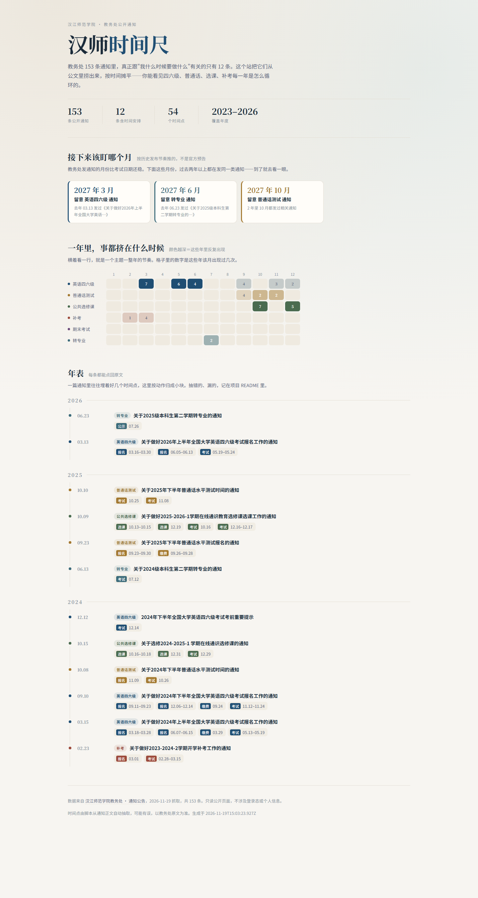

# 汉师时间尺



把汉江师范学院教务处的公开通知，变成一张能看的年历。

**线上 → [hjnu-calendar.pages.dev](https://hjnu-calendar.pages.dev)** ｜ **源码 → [github.com/ymcmhy9527/hjnu-calendar](https://github.com/ymcmhy9527/hjnu-calendar)**

不是又一个"校园信息聚合站"——它解决的是一个很具体的问题：**四六级什么时候报名、普通话几月开考、补考什么时候、选课在哪天、寒假从哪天放——这些每学期都有人问，答案埋在 212 条公文里。**

## 它做了什么

| 步骤 | 做法 |
|---|---|
| 抓取 | 抓教务处 + 数建处「通知公告」共 11 页（212 条），只读公开页面 |
| 抽取 | 从正文里用规则引擎抽"日期 + 动作"，过滤掉落款、法条引用、新闻回顾 |
| 归并 | 同一篇通知里的多个日期按动作聚成「报名 03.16–03.30」这样的块 |
| 呈现 | 年度节律矩阵 + 按发布节奏推的"下个月该盯什么" + 分年年表 |

线上页面：`dist/index.html`（单文件，样式内联，26 KB，无外部依赖）。

## 跑起来

```bash
node scripts/crawl.mjs    # 抓取 → data/notices.json + data/events.json
node scripts/render.mjs   # 渲染 → dist/index.html
node scripts/serve.mjs    # 本地预览 http://127.0.0.1:3939
```

零依赖。不用 `npm install`——这个项目故意不引任何包。数据是静态的，不需要 SSR，少一层依赖就少一处崩。

## 数据从哪来（以及为什么不碰教务系统）

- ✅ `jwc.hjnu.edu.cn` 教务处通知公告：四六级、选课、考试、补考
- ✅ `it.hjnu.edu.cn` 教育数字化建设与管理处通知公告：**节假日、寒暑假**——教务处那边反而查不到
- ❌ `jwsys.hjnu.edu.cn` 教务系统 / `ehall` 办事大厅：需要登录态、涉及个人学籍信息

第三条线不是"技术上做不到"，是**不该做**。爬别人的成绩单不只是违规，也是简历上的黑点。

## 已知问题（都在 `scripts/crawl.mjs` 里可调）

1. **分类偶尔错**。`2024-03-15` 那条把"缴费截止 3/29"标成"考试"——因为分类只看日期前后 12 字，上下文里两个动作挨得太近。
2. **专升本章程会混进来**。它的"7 月 31 日前未取得毕业证取消录取资格"被识别成时间节点，但对在读生没意义。
3. **只有教务处一个源**。校历、寒假时间、期末考试周在教务处通知里查不到，散在学校公众号和学院站点，目前没接。
4. **2026 年数据偏少**。那年通知以专升本、教材为主，真正的学生时间点只有 2 条。

## 写进简历的话术

> **汉师时间尺**（个人项目）· 独立完成
> 针对高校教务信息"散落在公文里、学生反复打听"的问题，用 Node.js 写爬虫抓取教务处与数建处 212 条公开通知，用正则 + 近邻上下文的规则引擎抽取 225 个时间节点，再经落款识别、行政事务降权、教工事务剔除等噪声过滤，收敛为 15 篇真正含学生时间安排的通知；前端为零依赖静态生成器，产物 26 KB，部署在 Cloudflare Pages，push 即自动重建。
> - 技术：Node.js / 多源抓取 / 规则引擎 / 静态站点生成 / 数据清洗 / Cloudflare Pages
> - 线上：https://hjnu-calendar.pages.dev
> - 源码：https://github.com/ymcmhy9527/hjnu-calendar
> - 数据：覆盖 2020–2026、64 个可用时间点

**数字是真的，别改大。** 面试官会问"212 条里你怎么过滤掉 90% 的噪声的"，这才是加分项——你能讲清楚规则引擎怎么设计，比说"日活一万"有用。

## 还能往哪走

- 接校历（学校公众号 `mp.weixin.qq.com` 那几篇"2026-2027 学年校历来啦"）→ 补上"寒假什么时候放"这个最高频的问题
- 加订阅：邮箱/微信提醒"四六级报名开始了"→ 这才是能留住人的功能
- 复制到别的学校：换 `LIST_PAGES` 和选择器即可，规则引擎通用——**这可以作为第二个学校的案例，证明方案可迁移**

## 合规

只用公开页面，不采集任何个人信息，不做自动抢课/代报名。页面底部标注数据来源与抓取时间。
